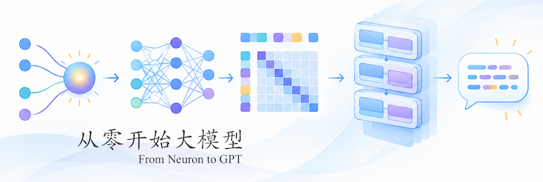

[](README.md)
[](README.zh-CN.md)
[](https://colab.research.google.com/github/gptmini/from-neuron-to-gpt/blob/main/tutorial/zh/artificial-neural-network/01-multilayer-perceptron/01-linear-regression.ipynb)
[](https://github.com/gptmini/from-neuron-to-gpt/stargazers)
[](LICENSE)



# From Neuron to GPT

**📖 Read the book online: [gptmini.github.io/from-neuron-to-gpt](https://gptmini.github.io/from-neuron-to-gpt) — in English and 中文.**

A tutorial that starts from a single neuron and builds a GPT by hand, step by step, using nothing but NumPy. It is available in Chinese and English.

It uses no deep learning framework such as PyTorch or TensorFlow. Automatic differentiation, network layers, optimizers, attention, the Transformer, training, inference, and fine-tuning are all implemented from scratch, and each is explained step by step in a Jupyter Notebook.

* Code repository: [gptmini/from-neuron-to-gpt](https://github.com/gptmini/from-neuron-to-gpt)
* License: [MIT License](LICENSE)

## Features

* **No framework dependencies**: only NumPy. We start from tensors, computational graphs, and backpropagation, so you can understand every line of code;
* **Step by step**: from a single neuron to GPT, supervised fine-tuning (SFT), and direct preference optimization (DPO), with only a few new concepts per chapter;
* **Explanations alongside code**: each chapter is a self-contained, runnable notebook, and most chapters end with exercises;
* **CPU only**: no GPU required. The default GPT model has about 10.8M parameters and can be trained on a laptop.

## Table of contents

The tutorial has two parts with 34 chapters in total, plus one framework summary. **Chapter numbers in the two parts are independent**: Part 1 uses 01–16 and Part 2 uses 01–18.

### Part 1: Neural network fundamentals

Directory: `artificial-neural-network`, under `tutorial/zh` (Chinese) and `tutorial/en` (English).

| Directory                     | Chapters | Contents                                                                                                                                         |
|-------------------------------|----------|--------------------------------------------------------------------------------------------------------------------------------------------------|
| `01-multilayer-perceptron`    | 01–10    | Linear regression, loss function, gradient descent, automatic differentiation, learning rate, iteration, batch, epoch, hidden layer, activation function |
| `02-recurrent-neural-network` | 11–16    | Encoding, embedding, cross-entropy loss, recurrent neural network, Adam optimizer, learning rate scheduler                                       |
| `03-core-framework`           | Summary  | Consolidates the previous 16 chapters into a complete core deep learning framework (`src/core`)                                                  |

### Part 2: Large language model fundamentals

Directory: `large-language-model`, under `tutorial/zh` (Chinese) and `tutorial/en` (English).

| Directory         | Chapters | Contents                                                                                    |
|-------------------|----------|---------------------------------------------------------------------------------------------|
| `01-tokenizer`    | 01–02    | Token embedding, position embedding                                                         |
| `02-attention`    | 03–06    | Self-attention, causal attention, weighted attention, multi-head attention                  |
| `03-pre-training` | 07–10    | Residual connection, normalization, dropout, model persistence                              |
| `04-inference`    | 11–14    | Sampling strategies (temperature, top-k, top-p), stopping criteria, KV cache, batch inference |
| `05-fine-tuning`  | 15–18    | SFT data preparation and training, DPO data preparation and training                        |

## Quick start

### Requirements

* Python 3.10 or later
* Dependencies: `numpy`, `matplotlib`, `requests`, `jupyter-book`

### Installation

```bash
git clone https://github.com/gptmini/from-neuron-to-gpt.git
cd from-neuron-to-gpt

python -m venv .venv
# Windows: .venv\Scripts\activate
source .venv/bin/activate

pip install -r requirements.txt
pip install jupyterlab
```

### Data

The tutorial uses tinyshakespeare, a collection of Shakespeare's plays, as training data. It is stored at `data/tinyshakespeare.txt`.

### Running the tutorial

Run `jupyter lab` from the project root, then open the notebooks under `tutorial/zh` (Chinese) or `tutorial/en` (English) in numerical order. If Python cannot find the `src` module, see the FAQ at the end of this page.

### Running the full pipeline from the command line

If you only want to train the models and don't want to read the chapters, run the three scripts in order from the project root:

```bash
python -m src.gpt.gpt   # Pre-training: download the data, train the GPT, generate sample text
python -m src.sft.sft   # Supervised fine-tuning: prepare SFT samples, train, generate sample text
python -m src.dpo.dpo   # Direct preference optimization: prepare DPO samples, train, generate sample text
```

The three stages depend on each other, so run them **in order**:

| Stage        | Depends on                | Output (all in `data/`)                               |
|--------------|---------------------------|-------------------------------------------------------|
| Pre-training | `tinyshakespeare.txt`     | `tinyshakespeare-gpt.npz`                             |
| SFT          | Pre-trained model         | `sft-samples.pkl`, `tinyshakespeare-sft.npz`          |
| DPO          | Pre-trained model, SFT model | `dpo-samples.pkl`, `tinyshakespeare-dpo.npz`       |

`03-pre-training/10` produces the pre-trained model, which `04-inference` and `05-fine-tuning` then use in turn.

## Model size

The default GPT configuration is as follows. It corresponds to the Part 2 chapter “Model Persistence” (`03-pre-training/10`) and to `src/gpt/gpt.py`:

| Parameter                  |          Value |
|----------------------------|---------------:|
| Context size               |            256 |
| Embedding size             |            384 |
| Attention heads            |              6 |
| Transformer blocks         |              6 |
| Batch size                 |             16 |
| Epochs                     |             10 |
| Vocabulary (character-level) |           65 |
| Parameters                 | about 10.8M    |

The chapters before `03-pre-training/10` use smaller configurations so that they run quickly. The “Model Persistence” chapter switches to the configuration above, in order to train a model that is usable for inference and fine-tuning. The model is trained entirely on the CPU and is small. The goal is to see the principle behind every step clearly, not to maximize generation quality.

### Environment and running time

All the code was developed on a Mac mini M4 with 16 GB of memory and runs entirely on the CPU.

* Pre-training (default configuration): about 1 to 2 hours;
* In fine-tuning, DPO data preparation generates the rejected samples one by one, which is usually the slowest step.

Running time depends on the CPU, the number of cores, and the BLAS library that NumPy is linked against, and it can differ greatly between machines.

## Project structure

```text
.
├── data/                       # Training data (tinyshakespeare) plus the model parameters and samples produced by training
├── src/
│   ├── core/                   # Core framework: tensors, layers, activation functions, loss functions, optimizers,
│   │                           #         learning rate schedulers, datasets, trainers
│   ├── gpt/                    # GPT model, dataset, loss function, trainer; gpt.py is the pre-training script
│   ├── sft/                    # Supervised fine-tuning; sft.py is the fine-tuning script
│   └── dpo/                    # Direct preference optimization; dpo.py is the optimization script
├── tutorial/
│   ├── en/                     # English tutorial (Jupyter Notebooks)
│   │   ├── artificial-neural-network/
│   │   ├── large-language-model/
│   │   └── myst.yml            # 教程站点（MyST / Jupyter Book）配置
│   └── zh/                     # Chinese tutorial, same structure as en
├── requirements.txt
└── LICENSE
```

## Acknowledgments and references

The training data, tinyshakespeare, comes from Andrej Karpathy's [char-rnn](https://github.com/karpathy/char-rnn) project.

Main references:

* Vaswani et al., *Attention Is All You Need*, 2017.
* Radford et al., *Language Models are Unsupervised Multitask Learners* (GPT-2), 2019.
* Kingma and Ba, *Adam: A Method for Stochastic Optimization*, 2014.
* Loshchilov and Hutter, *Decoupled Weight Decay Regularization* (AdamW), 2017.
* Rafailov et al., *Direct Preference Optimization: Your Language Model is Secretly a Reward Model*, 2023.

---

If this tutorial helps you, a ⭐ on the repo helps others find it.